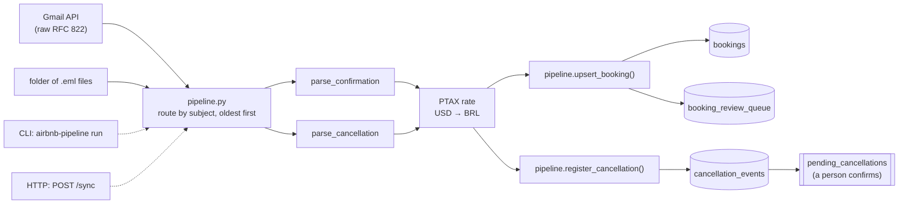

# airbnb-booking-pipeline

**Production pipeline · real Airbnb host data · anonymized for publication**

[](https://github.com/AllanDionizio/airbnb-booking-pipeline/actions/workflows/ci.yml)
[](LICENSE)

Airbnb tells a host about every booking and every cancellation by email, in a layout made for people. This pipeline reads those emails (confirmations and cancellations, priced in BRL or USD), parses them, converts USD at the Brazilian central bank's rate and loads them into Postgres. Reading the same email twice changes nothing, and anything it cannot settle on its own (an unknown listing, a double booking, a cancellation) waits in a queue for a person instead of being dropped or guessed.

Built for and run in production at a short-term rental management company operating a multi-property Airbnb portfolio. Validated against hundreds of real host emails. This repo is a clean-room rewrite for publication: the code was written again from scratch, and every email, listing, guest and amount in it is synthetic.

## Quickstart

```bash
git clone https://github.com/AllanDionizio/airbnb-booking-pipeline.git && cd airbnb-booking-pipeline
python -m venv .venv && source .venv/bin/activate
make setup && make demo   # needs Docker
```

`make demo` starts Postgres from an empty volume and runs the pipeline over a sample inbox of 22 synthetic emails ([Demo](#demo) shows the output). New to the emails themselves? [`docs/sample-email.md`](docs/sample-email.md) walks through a confirmation and a cancellation line by line, with an English translation.

## How it works



[`pipeline.py`](src/airbnb_booking_pipeline/pipeline.py) runs each email through the same steps: route it by subject (a cancellation without a subject is recognized by its body), parse it, convert USD amounts with the PTAX rate of the day the email arrived in `BUSINESS_TZ` (default `America/Sao_Paulo`), and load it. Emails are processed oldest first, so a newer email for the same booking wins.

Every email ends with a result code: the database's codes below, or one of three the pipeline sets itself when the email never reaches the database (`UNRECOGNIZED`, `PARSE_ERROR`, `FX_ERROR`). A bad email is reported and the run goes on; a database error stops the run, and rerunning is safe because every email is idempotent.

### Parsers

The two parsers in [`parsers/`](src/airbnb_booking_pipeline/parsers/) read the text part of Airbnb's Portuguese host emails with regular expressions. The confirmation parser takes the booking code, guest, listing, dates and the host payout block line by line; an unknown payout label is a `PARSE_ERROR` rather than a skipped line, and the lines have to add up to the payout total. The cancellation parser tells a full refund from a penalty by whole sentences, because "full refund" also appears as a button in the emails that carry a penalty.

### Exchange rate

Bookings priced in USD are converted to BRL in [`enrich/fx.py`](src/airbnb_booking_pipeline/enrich/fx.py) with the Banco Central do Brasil's PTAX sell rate (public Olinda API). The latest quote on or before the requested day covers weekends and holidays. If PTAX is down, an optional `USD_BRL_FALLBACK` rate is used; without it the conversion fails loudly instead of guessing.

### Database

Postgres 16, defined in [`sql/`](sql/) and started with Docker Compose. Bookings go in through one SQL function, [`pipeline.upsert_booking(jsonb)`](sql/002_upsert_booking.sql), called from [`load/postgres.py`](src/airbnb_booking_pipeline/load/postgres.py). The function decides what happens to each confirmation email:

| Result | When |
|---|---|
| `CREATED` / `UPDATED` | New booking, or a newer email for a booking still in `draft` |
| `ALREADY_PROCESSED` | The same email again: the earlier outcome is returned and nothing changes |
| `ALREADY_EXISTS` | The booking left `draft` (a person confirmed it), so the pipeline does not overwrite it |
| `QUEUED_UNKNOWN_LISTING` / `QUEUED_NO_CONTRACT` / `QUEUED_OVERLAP` | Sent to `booking_review_queue` with the original payload, for a person to resolve |
| `INVALID_PAYLOAD` | Malformed input; nothing is written, so the email can be retried |

Cancellation emails go through [`pipeline.register_cancellation(jsonb)`](sql/003_register_cancellation.sql), which records each one in `cancellation_events` and matches it to its booking, or to an open review-queue item when the confirmation is still waiting there. A cancellation that arrives before its booking is kept, and it shows up for a person once the booking is loaded. The pipeline never cancels anything: it flags the booking, and a person confirms the cancellation from the `pending_cancellations` view. A penalty is stored as the email states it and in BRL (USD at the PTAX rate). Full refunds carry no amount and no currency.

Idempotency is per email (`processed_messages` for confirmations, `cancellation_events` for cancellations), so replaying an old email never rolls back a newer update. Two exclusion constraints back the rules up: no two live bookings of a listing share a night, and no listing has two contracts in force on the same day. `host_payout` is a generated column, derived from the payout lines.

### Sources and the command line

Emails come from a source ([`sources/`](src/airbnb_booking_pipeline/sources/)): `LocalSource`, a directory of `.eml` files, or `GmailSource`, the host's mailbox. Both read the full RFC 822 message (Gmail's `raw` format) the same way, so the `Message-ID` header is the idempotency key whichever source an email came from. The command line runs either one:

```bash
airbnb-pipeline run --inbox path/to/emails   # uses $DATABASE_URL
airbnb-pipeline run --gmail
```

`GmailSource` calls the Gmail REST API with read-only access, through an OAuth refresh token obtained once, outside this repo (`GOOGLE_CLIENT_ID`, `GOOGLE_CLIENT_SECRET`, `GOOGLE_REFRESH_TOKEN`). By default it reads Airbnb's confirmation and cancellation emails from the last two days; `GMAIL_QUERY` takes any Gmail search instead. The window overlaps on purpose, because an email read twice comes back as `ALREADY_PROCESSED`. The listing follows every page, and more than 500 matches stop the run instead of leaving emails behind.

It prints how many emails ended in each code, then the ones a person has to look at (review queue, unmatched or undetermined cancellations, errors). `-v` logs every email.

### HTTP service

[`web.py`](src/airbnb_booking_pipeline/web.py) serves the same run over HTTP, for a container: `GET /` says the service is up, and `POST /sync` runs the pipeline once and answers with the summary as JSON (totals per result code and the emails that need a person). A run that finishes is a `200`, attention items included; Gmail failing is a `502` and the database failing a `503`, both safe to retry. The source is Gmail when the `GOOGLE_*` credentials are set, and the `.eml` files in `INBOX_DIR` otherwise. Every setting is checked at startup, so a missing one stops the container instead of the first sync. `/sync` has no authentication of its own: it is meant to run where the platform checks the caller, such as Cloud Run without public access.

The [`Dockerfile`](Dockerfile) installs the package with its `web` extra (Flask, gunicorn) as a non-root user. `make serve` runs the demo through it:

```bash
make serve                              # empty database + demo listings, then the app on :8080
curl -X POST localhost:8080/sync        # the sample inbox; run it twice to see nothing load again
```

## Test data

Every email in this repo is synthetic. A small generator in [`synthetic/`](src/airbnb_booking_pipeline/synthetic/) renders Airbnb's Portuguese host email layout from a spec, using fictional listings, `Guest <NATO letter>` names, `HMTEST…` booking codes and made-up amounts. It produces the 20 regression fixtures in [`tests/fixtures/`](tests/fixtures/) (14 confirmations, 6 cancellations), one per layout variant the parsers have to handle: USD amounts, nbsp between symbol and value, stays crossing New Year, discounts and promotions, the "full refund" button that appears in penalty emails, and emails forwarded through Gmail, which rewrites the text part from the HTML into a different layout. Each fixture stores the expected parser output, written by hand.

## Demo

`make demo` starts Postgres from an empty volume, loads the demo listings and contracts ([`data/demo_seed.sql`](data/demo_seed.sql)) and runs the pipeline over [`data/sample_inbox/`](data/sample_inbox/): 22 synthetic emails from a few months of a host's mailbox. The inbox is built to reach every result code: bookings in BRL and USD, a double booking, a stay after its owner contract ends, a listing nobody registered, cancellations with and without a penalty, one for a booking that is still in the review queue, one for a booking older than the inbox, a payout line the parser has never seen and a guest message. The run ends with this summary:

```text
22 emails processed
  booking       CREATED                    12
  booking       PARSE_ERROR                 1
  booking       QUEUED_NO_CONTRACT          1
  booking       QUEUED_OVERLAP              1
  booking       QUEUED_UNKNOWN_LISTING      2
  cancellation  FLAGGED                     2
  cancellation  FLAGGED_REVIEW_ITEM         1
  cancellation  NOT_FOUND                   1
  unrecognized  UNRECOGNIZED                1
```

followed by the 10 emails that need a person. Run `airbnb-pipeline run --inbox data/sample_inbox` again and every email that reached the database comes back as `ALREADY_PROCESSED`, with no new rows. The USD bookings use the live PTAX rate, so they need network access (or `USD_BRL_FALLBACK`).

## How it ran in production

The production version ran as a private Cloud Run service. Cloud Scheduler called it on a fixed schedule with an OIDC identity token; the service accepted no unauthenticated calls. The Gmail OAuth client and refresh token lived in Secret Manager, and the scheduler and the service ran as two separate service accounts: one could only invoke the service, the other could only read the secrets. Each run read the latest Airbnb emails from the host's mailbox and wrote them into the company's existing back-office database (Postgres) through SQL functions, where a person resolved the review queue.

This repo keeps that shape (a container answering `POST /sync`, the Gmail source, the rules inside SQL functions) but runs on its own: a standalone Postgres schema instead of the company's, and a sample inbox instead of the mailbox. The cloud deployment itself is not part of the repo.

## Lessons from production

- **The real layout is not the sample's.** The first parser was written before it met the production mailbox and had to be rewritten for the real layout. Here every fixture copies the structure of a real email, and the expected output is written by hand rather than derived from the generator.
- **New payout lines show up without notice.** Discount and promotion lines the parser had never seen kept turning up in real emails. Skipping an unknown line would quietly change what the host is paid, so an unknown label is a `PARSE_ERROR` and the lines must add up to the payout total.
- **A search filter is a silent drop.** For a while the Gmail search matched only confirmation subjects, so cancellation emails never reached the pipeline: no error, no warning. Here an email that is neither a confirmation nor a cancellation is reported as `UNRECOGNIZED`, and the default search covers both subjects.
- **Observe before acting, and keep a person in the loop.** Cancellations went live in steps: first recorded with no side effect, then acted on, and in the end the automation stopped cancelling bookings on its own. `register_cancellation` only flags a booking, and a person confirms it.
- **"Full refund" appears in emails that are not full refunds.** Every penalty email carries an "Issue full refund" button, so a loose match reads a penalty as a refund. The parser matches whole sentences and tests the penalty first ([`docs/sample-email.md`](docs/sample-email.md) shows the button).
- **Forwarding rewrites the email.** Gmail does not forward the original text part; it builds a new one from the HTML, with other headings and line breaks. Running this rewrite's Gmail source against a real test mailbox found it, and the parser now reads both layouts.

The rewrite also changed a few things on purpose:

- Idempotency moved to a ledger per email. With the email id stored on the booking row, replaying an older email would have rolled back a newer update.
- The Gmail listing follows every page and fails above 500 matches. The first version read a fixed number of messages per run and would have dropped the rest without a word.
- A full refund carries no currency. The original defaulted it to BRL, which was wrong for USD bookings.

## Known limitations

- **Forwarded emails take the forwarding date.** The parser infers the stay's year from the email date, and the pipeline picks the PTAX day from it. For a forward, that is the day it was forwarded, not the day Airbnb sent it, so a forward sent long after the booking can land on the wrong year or rate.
- **The default Gmail search does not match forwards.** It looks for emails from Airbnb's sender address, and a forward comes from the person who forwarded it. Forwards go in through `--inbox` or a custom `GMAIL_QUERY`.
- **Airbnb, in Portuguese, only.** The parsers read the pt-BR host layout. An email in another language comes back as `UNRECOGNIZED`, and other booking channels are out of scope.

## Development

```bash
python -m venv .venv && source .venv/bin/activate
make setup   # pip install -e ".[dev]" + pre-commit hooks
make lint    # ruff check + ruff format --check
make test    # pytest
make fixtures  # regenerate tests/fixtures/ from the generator
make inbox     # regenerate data/sample_inbox/ from the generator

make db-up             # Postgres on localhost:5433, schema loaded from sql/
make test-integration  # integration tests against it
make db-reset          # start over from an empty database
make serve             # demo database + the app container over the sample inbox
```

CI runs ruff, the unit and regression tests on Python 3.11 and 3.14, the integration tests against a Postgres service, and a build of the image that checks it serves.

## About this repo

Built with AI-assisted coding (Claude Code); the architecture, the production debugging and the design decisions recorded in [`docs/adr/`](docs/adr/) are mine.

## License

[MIT](LICENSE)
